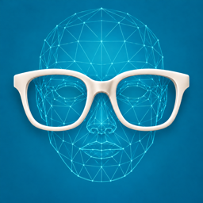
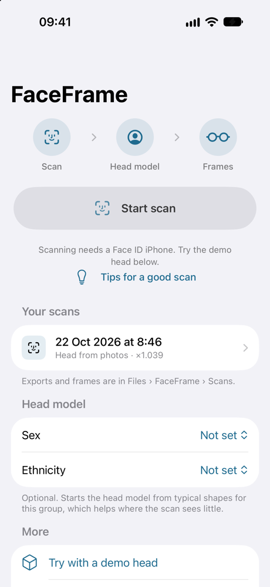
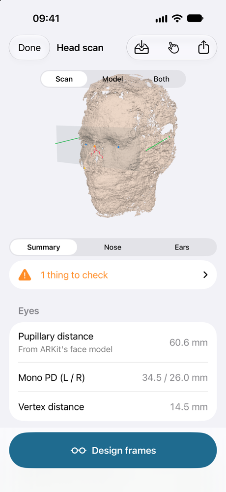
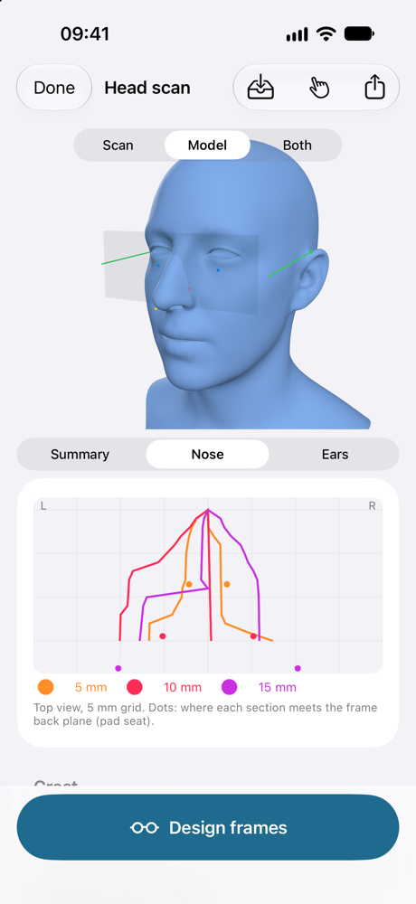
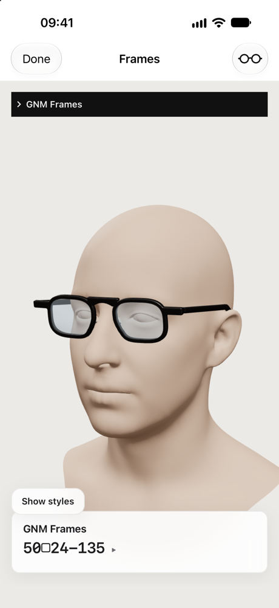
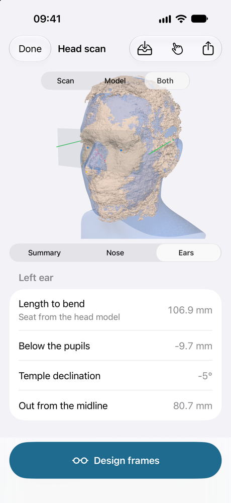
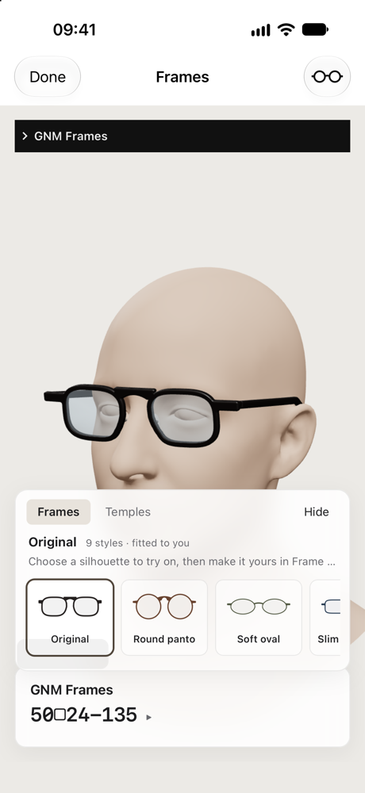
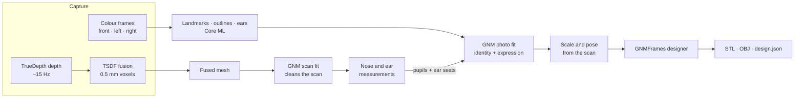

<div align="center">



# FaceFrame

**Scan your head with your iPhone. Get 3D-printable glasses that fit.**

FaceFrame scans the head with the TrueDepth camera, fits a [Google GNM](https://github.com/google/GNM) head model to it,
measures where glasses sit on the **nose** and **ears**, and designs printable frames for that head, all on the phone.

[](https://github.com/google/GNM)


[](LICENSE)

</div>

<p align="center">
  
  
  
  
</p>

---

## Highlights

- **0.5 mm head scan on the phone.** TrueDepth depth frames are fused into a sparse TSDF volume while you turn your head, guided by spoken prompts.
- **A full head from a partial scan.** A [Google GNM](https://github.com/google/GNM) head is fitted to three colour photos taken during the scan, then sized and posed on the scan itself. The ears, the back of the head and the eyes are complete even where the camera saw little.
- **Measurements an optician uses.** Bridge crest and sellion, nose cross-sections every 1 mm (DBR at 5/10/15 mm, splay and frontal angles), ear seats, temple length to bend, PD and mono PD.
- **Frames designed for your head.** The built-in GNMFrames designer offers 9 styles sized to the fitted head (for example `50□24-135`), and you can try on an existing pair from an OBJ file.
- **Ready to print.** `frames.stl`, `lenses.stl`, `head.stl`, `frames.obj` and `design.json`, all in millimetres, saved to Files and shared from the app.
- **Everything stays on the device.** Fusion, fitting, Core ML detectors and the frame designer all run locally.

## Screenshots

| Fused scan | Head model + nose | Scan + model, ears |
|:---:|:---:|:---:|
|  |  |  |
| The TrueDepth scan with the frame back plane, pupils and ear seats. | The photo-fitted GNM head. The nose tab shows the cross-sections and pad seats. | Scan and model overlaid. Temple length, drop and declination per ear. |

| Home | Frame designer | Styles |
|:---:|:---:|:---:|
|  |  |  |
| Scan, saved scans and the optional head-model prior. | Frames sized for the fitted head, ready to export for printing. | Pick a silhouette and adjust frames and temples. |

## Getting started

**Requirements:** Xcode with the iOS 17 SDK or later, and a Face ID iPhone or iPad to scan.

1. Clone the repository and open `FaceFrame.xcodeproj`.
2. Pick your team under **Signing & Capabilities**.
3. Run on a Face ID device and tap **Start scan**.

> [!TIP]
> No TrueDepth camera in the simulator? Tap **Try with a demo head** to explore the review screen, the frame designer and the exports. A recorded capture can also be replayed in the simulator (see [Raw captures and replay](#raw-captures-and-replay)).

**For a good scan:** take off glasses, earbuds and earrings, tuck your hair behind your ears, use even indirect light, hold the phone at eye level about 30 cm away, keep a neutral expression, and turn your head slowly while the phone stays still. Turn the sound on: spoken prompts guide you while your head is turned.

## How it works



1. **Capture** (`Scan/ScanController.swift`). ARKit face tracking gives the head pose at 60 Hz. TrueDepth depth frames (`ARFrame.capturedDepthData`, about 15 Hz, 640×480) are fused in the head's own coordinate frame, so the user keeps the phone still and turns their head. Spoken prompts guide them through front, left ear, right ear, chin up and chin down.
2. **Calibration** (`Core/FusionEngine.swift`, `Core/PoseCorrection.swift`). In the first slow, frontal frames:
   - **Depth mapping:** each possible mapping (mirrored or not, depth calibration or camera intrinsics) is tested. Mirroring is re-checked on turned frames during the scan, and fusion restarts if it was wrong.
   - **ARKit correction:** ARKit's face mesh is fitted to the TrueDepth points. On a real device, ARKit's monocular face fit was about 6 cm too deep: a face too large and too far away. A scale along the camera rays and a small rigid offset correct every ARKit pose and the eye positions. TrueDepth depth is treated as the metric truth.
3. **Fusion** (`Core/TSDFVolume.swift`). A sparse TSDF volume with 0.5 mm voxels and projective integration, run across several threads (about 11 ms per frame on an M-series Mac).
4. **Alignment** (`Core/SDFAligner.swift`). Each frame is lined up against the fused model (Gauss-Newton point-to-SDF fit, with a weak pull toward ARKit's pose). This removes ARKit's millimetre jitter and keeps tracking at 60°+ head turns, where ARKit loses the face but the ears come into view.
5. **Mesh** (`Core/SurfaceNets.swift`, `Core/TriMesh.swift`). Surface Nets, then keep the largest connected piece and apply light Taubin smoothing.
6. **Fit analysis** (`Core/FitAnalysis.swift`).
   - **Nose:** a 0.2 mm front height map gives the ridge profile. The sellion is the deepest point under the line from the glabella to the nose tip. Cross-sections every 1 mm for 25 mm below the bridge crest give DBR at 5/10/15 mm in the frame back plane, the splay angle, the frontal angle and the pad contact lines.
   - **Ears:** a side height map of each side of the head is compared with a robust cubic fit of the skull; whatever sticks out is the ear. The ear seat is the highest point of the groove between the skull and the helix, found in coronal slices of the mesh. If no groove is found, it falls back to the ear outline.
   - **Eyes:** PD and mono PD from ARKit's eye centres.
7. **Review.** A 3D view with every landmark drawn on it. Re-place the crest or either ear seat by tapping the model (**Adjust**), and all derived values update.
8. **Frames.** **Design frames** opens the frame designer on the fitted head.
9. **Save and export.** See [Files](#files).

## The head model: Google GNM

[](https://github.com/google/GNM)

The frames are made for a [Google GNM](https://github.com/google/GNM) head (Apache 2.0) whose **identity comes from the colour photos** and whose **size comes from the scan**. This is GNM's `demos/fit_head_to_images.py` followed by an alignment to the scan, ported to Swift and run on the phone.

<details>
<summary><b>Photo fit</b> (<code>Scan/PhotoObservations.swift</code>, <code>Core/PhotoFit.swift</code>)</summary>

During every scan the app keeps three colour frames: the most frontal one and the most turned one to each side (at least 45° of head yaw). Each is turned upright and observed the way GNM's photo fit observes a photo, with the same detectors converted to Core ML (in `FaceFrame/Resources/Models`):

- **68 iBUG landmarks:** face-alignment's 2D-FAN-4 (BSD-3), flip-averaged, with face_alignment's crop and heatmap decoding. Vision finds the face box that S3FD finds in Python.
- **Profile and hair outlines:** MediaPipe's selfie multiclass segmenter (Apache 2.0), then `extract_outlines`.
- **Ear helix** in the side views: Ear_Landmarker (Apache 2.0), cropped where GNM's ear projects.
- **Initial head poses:** ARKit's pose of each frame, where the Python script uses PnP.

`PhotoFitter` then ports `fit()`: one identity (GNM's 173 head and eye components) and one expression (383) shared by all views, and one pose per view. It uses the same losses (Huber landmarks, outermost-point outlines, ear helix to the model's ear rim, hair 10 mm thick), the same Gaussian priors (the sex/ethnicity class from the home screen when set) and the same Adam schedule, with analytic gradients. At neutral pose GNM is linear in identity and expression, which the exported expression basis relies on.

On the three frames of a real capture, the port matched GNM's Python fit closely:

| | Python (`fit_head_to_images.py`) | On the phone (port) |
|---|---|---|
| Final losses: landmarks / outline / ears | 1.57 / 1.30 / 0.013 | 1.92 / 1.30 / 0.018 |
| Identity | — | correlation 0.97; neutral heads 1.4 mm apart (median vertex) |
| Frames (GNMFrames) | 45□23-125, PD 57.9 | 44□23-125, PD 57.3 |

The landmark loss is a little higher, probably because Vision's face box differs from S3FD's. On an M1 Mac the photo stages take about 33 s: detection 8 s, fit 9 s and sizing on the scan 15 s.

</details>

<details>
<summary><b>Anchored to the scan</b></summary>

On its own, the photo fit gave a head that was too narrow for the scan: a PD of 57.3 mm against 62.2 mm measured, and ear seats about 10 mm too far in. The photo fit therefore also takes four **anchors** measured on the scan:

- **Pupils:** the far pupils found in the colour frames, matched to GNM's `pupils` vertices.
- **Ear seats:** the seats measured on the scan, matched to the GNM vertex at each seat on the head fitted to the scan.

A similarity (rotation, translation and uniform scale) from the head to the scan is solved with everything else. Each anchor coordinate adds a Huber term on its error in mm, weighted so that 1 mm costs as much as a landmark off by 1% of the face size. The photos keep deciding the shape; the anchors add the metric relations between pupils and ears that photos get wrong.

On that capture the photo losses hardly changed (landmarks 1.91, outline 1.33, ears 0.016). The anchors were met to 1.2 mm (pupils) and 0.5 mm (ear seats), at a similarity scale of 1.045.

| Same capture, frames for this head | Photos only, scale from the profile (0.98) | With anchors, scale from them (1.045) | Measured |
|---|---|---|---|
| PD | 57.3 mm | 61.9 mm | 62.2 mm (images) |
| Size (default style) | 44□23-125 | 50□24-130 | — |
| Hinge to bend, 48□23 frame | 95 mm | 100 mm | 110 mm (the wearer's glasses) |

The remaining 10 mm of hinge-to-bend length is probably mostly definition: GNMFrames places the ear seat where the temple rests on the ear root, and a stock temple usually starts its bend a little behind that.

</details>

<details>
<summary><b>Size from the scan</b> (<code>Core/GNMScaleAlign.swift</code>)</summary>

With identity and expression fixed, the head is aligned with the scan by robust symmetric point-to-plane ICP (pitch and translation only; the scan frame is already level) on the regions TrueDepth sees as skin.

The scale is the anchors' scale when there are anchors. Otherwise it is chosen from a grid from 0.90 to 1.04: the scale whose midline profile best matches the scan wins. On the same capture the profile chose 0.98 (Python: 0.96), but its error barely changes between 0.94 and 1.04 and has several minima, so on its own it is good to only a few percent. The pupils and ear seats span the whole head and pin the scale better. Without anchors, the port's aligned head and Python's were 1.5 mm apart (median).

</details>

<details>
<summary><b>Scan fit</b> (<code>Core/GNMFit.swift</code>)</summary>

GNM is also fitted to the scan itself: point-to-plane Gauss-Newton on the first 80 identity components, with the same prior, pulled to the pupils measured in the colour frames since the surface fit leaves the eyes out. It tells real skin from artifacts (earbuds, stubble fuzz, the smear under the jaw), which are removed from the scan, and it anchors the review screen's crest height and ear seats. The nose is measured on the scan.

Cleaning the scan with the photo-fitted head instead cut into the nose: that head follows the scan less closely. The scan fit is also the head model when there are no usable photos, for example without a side view.

</details>

The GNM model files ship in `FaceFrame/Resources/GNMFrames` (about 28 MB with the expression basis), shared by the fits and the frame designer. Their license is in [`GNM_LICENSE.txt`](FaceFrame/Resources/GNMFrames/GNM_LICENSE.txt). The Core ML detectors add about 62 MB.

## Frame designer

**Design frames** opens GNMFrames on the head model: the photo-fitted head at the scan's scale, or the scan fit. It is the same viewer as on the desktop, built for the app and shown in a web view. The app serves its page, script and model files from the bundle through a custom URL scheme, passes the fitted identity in `window.faceframeHead`, and receives exports through a message handler.

- **Style:** pick one of 9 silhouettes, then adjust frames and temples.
- **Export › Save all files for printing:** `frames.stl`, `lenses.stl`, `head.stl`, `frames.obj` and `design.json` go to Files › FaceFrame › Scans › `<scan>` › frames, and the share sheet opens.
- **Try on an existing pair:** the glasses button in the toolbar loads an `.obj` from Files. It is shown on the head instead of the designed frames, coloured where it cuts into or comes close to the head, with a fit report. For testing, set `FACEFRAME_TRYON_OBJ=<path>` in the launch environment to load an OBJ when the designer opens.

## Files

Tap the tray button on the review screen to keep a scan. Saved scans are listed under **Your scans**: tap one to reopen it, swipe or touch and hold to delete it. Reopening recomputes only the scan analysis from the saved surface (a few seconds) and does not run the fits again.

Everything lives in **Files › FaceFrame › Scans › `<scan>`**:

| File | What it is |
|---|---|
| `scan.mesh` | The cleaned scan (point cloud and mesh), LZFSE-compressed, about 30 MB |
| `head.mesh` | The head model |
| `session.json` | Head-model identity, scale, source and prior; measurements added by the fits; landmark adjustments; scan diagnostics |
| `*.stl`, `*.ply`, `fit.json` | Exports, in millimetres. Origin at the bridge crest; +x is the subject's left, +y up, +z forward |
| `*_head_completed.stl` | The completed head; `fit.json` › `headModel` describes it (`identity`, `headScale`, `source`: `photos` or `scan`, `prior`) |
| `frames/` | `frames.stl`, `lenses.stl`, `head.stl`, `frames.obj`, `design.json` |

## Raw captures and replay

Turn on **Record raw capture** on the home screen before scanning. Every depth frame is saved to Files › FaceFrame › Captures (80–200 MB per scan), together with the ARKit head pose interpolated at the depth timestamp, the camera intrinsics and depth calibration, the eye centres, and about 7 colour images per second with their intrinsics and raw ARKit pose.

Recorded captures appear under **Replay a recorded capture** on the home screen. Replaying one runs it through the same fusion, fits (photo fit included) and measurements as a live scan, then opens its review and the frame designer. Each replay writes a detailed log with stage timings to Scans › `replay_<capture>.log`. Share a capture as a zip from the review screen (**Adjust › Share raw capture**).

Replay also works in the **iOS simulator**: copy a capture folder into the app's `Documents/Captures`. A Release build in the simulator ran a whole replay in 46 s (fusion 9 s, scan fit 7 s, cleanup 8 s, photo stages 14 s) and matched the Mac run. Two simulator differences:

- **Core ML** is forced to the CPU there; its default path returned NaN.
- **Vision's face landmarks** give no usable pupils there, so the PD falls back to ARKit's and only the ear seats anchor the photo fit (scale 1.039 instead of 1.045).

## Validation

The core pipeline was tested against an analytic synthetic head, with rendered depth at 0.6 mm noise and head poses perturbed by about 3 mm / 0.6°:

| Check | Result |
|---|---|
| Alignment error | 3 mm → about 0.15 mm |
| Mesh vs. ground truth | about 0.05 mm median |
| Ear seat, left vs. right | match within about 1 mm |

## Known limitations

- A narrow groove behind the top of the ear is partly hidden from the camera. The surface bridges it, so the reported seat is roughly where a 3–4 mm temple would rest, not the very bottom of the groove.
- Hair over the ears hides the ear seat. Tuck it away or use a swim cap.
- The frame fit model is simple: a vertical back plane touching the crest, with no pantoscopic tilt.
- Full-resolution STL files are large (about 1.5 M triangles, about 70 MB).

## Project layout

```
FaceFrame/
├── App/         App entry and home screen
├── Scan/        Capture, colour frames, photo observations, replay, reconstruction
├── Core/        Fusion (TSDF, SDF alignment, Surface Nets), fit analysis, GNM fits
├── Review/      3D review, nose profile, saved scans, export, frame designer
└── Resources/
    ├── GNMFrames/   GNM model files and the GNMFrames web viewer
    └── Models/      Core ML detectors (face landmarks, ears, segmentation)
```

## Acknowledgements

- [Google GNM](https://github.com/google/GNM): the parametric head model (Apache 2.0, see [`GNM_LICENSE.txt`](FaceFrame/Resources/GNMFrames/GNM_LICENSE.txt)).
- [face-alignment](https://github.com/1adrianb/face-alignment) 2D-FAN-4 (BSD-3) for the 68 facial landmarks.
- [MediaPipe](https://github.com/google-ai-edge/mediapipe) selfie multiclass segmenter (Apache 2.0) for the profile and hair outlines.
- Ear_Landmarker (Apache 2.0) for the ear helix.

## License

FaceFrame is released under the [Apache License 2.0](LICENSE).

The bundled third-party models keep their own licenses: the GNM model files are Apache 2.0 ([`GNM_LICENSE.txt`](FaceFrame/Resources/GNMFrames/GNM_LICENSE.txt)), the face-alignment landmark detector is BSD-3, and the MediaPipe segmenter and Ear_Landmarker are Apache 2.0.
